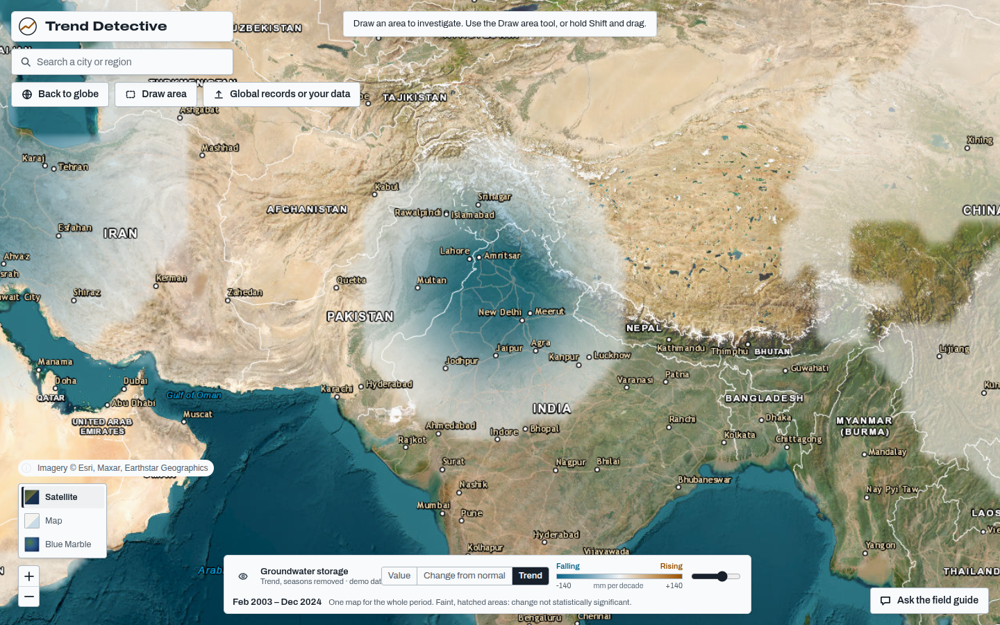

# Trend Detective

**NASA Space Apps Challenge 2026** · Challenge: [Be An Earth System Trend Detective!](https://www.spaceappschallenge.org/2026/challenges/earth-system-trend-detective/)

**A tool for detecting human impact on Earth from trends in NASA satellite data.**

Pick a place on the globe and a variable, such as groundwater, NO₂, night lights or vegetation. Trend Detective downloads the NASA data for that area, builds a monthly time series and tells you whether the trend is real or noise. You get a chart, a p-value and a plain-language verdict. It is built for high school and college students, so you don't need a science background to use it.



## What it does

- **Any area on Earth.** Draw a box on the map, search for a city or click a named region. The analysis uses the region's real boundary.
- **18 variables from 7 NASA products and NOAA records**, grouped by sphere (water, land, atmosphere).
- **Statistics on every trend:** OLS slope with a t-test and confidence intervals, the Mann-Kendall test and Sen's slope. A trend counts as significant only when both tests agree (p < α). Seasons can be removed before fitting.
- **Signal against control.** You can put two variables side by side. For example, groundwater falls in Punjab while rainfall stays flat, which points to pumping rather than drought.
- **NASA GIBS imagery** on the map and on the 3D globe, with a timeline. A trend map shows where in the area the change happened.
- **Field guide chat.** An LLM explains the result you are looking at. It only uses the numbers from your result.
- **Your own data.** Upload a CSV (`date,value`) and run the same analysis on it.
- **CSV export** of every series.

## Example investigations

You can open these cases with one click. Their data is committed to the repo, so they work without a NASA login.

| Case | Variable(s) |
|---|---|
| Is Punjab running out of groundwater? | GLDAS groundwater storage vs. GPM rainfall |
| Is Delhi's air getting dirtier? | OMI NO₂ |
| Is Delhi spreading out at night? | VIIRS night lights vs. NO₂ |
| Did China clean up its coal smoke? | MERRA-2 sulfate vs. SO₂ |
| Is Phoenix heating up? | MODIS night vs. day land surface temperature |
| Is the Amazon in Rondônia losing its forest? | MODIS NDVI |
| Is the Sahel turning into desert? | MODIS NDVI vs. GPM rainfall |
| How fast is CO₂ rising? | Mauna Loa CO₂ (NOAA) |
| Is methane still climbing? | Global marine CH₄ (NOAA) |

## Data

| Product | Variables | Source |
|---|---|---|
| GLDAS CLSM 0.25° daily v2.2 (GRACE assimilated) | groundwater, terrestrial water storage | GES DISC, OPeNDAP |
| GPM IMERG monthly v07 | precipitation | GES DISC, OPeNDAP |
| OMI OMNO2d v004 | tropospheric NO₂ | GES DISC, OPeNDAP |
| MERRA-2 M2TMNXAER | dust, black carbon, organic carbon, SO₂, sulfate, total and sulfate AOD | GES DISC, OPeNDAP |
| MODIS MOD11C3 v061 | day and night land surface temperature | LP DAAC, OPeNDAP |
| MODIS MOD13C2 v061 | NDVI | LP DAAC, OPeNDAP |
| VIIRS Black Marble VNP46A3 v002 | night lights | LAADS DAAC, OPeNDAP |
| NOAA GML | Mauna Loa CO₂, global marine CO₂ and CH₄ | NOAA text files |

All the data is real and there is no demo fallback. If a source fails, the analysis stops with a readable error. Every provider returns the same thing: a monthly area-mean series in catalog units. The variables live in [`backend/app/catalog/variables.yaml`](backend/app/catalog/variables.yaml). To add a variable from an existing product, you only add an entry to that file.

## Tech stack

**Backend:** Python, FastAPI, Pydantic, xarray, NumPy, pandas, SciPy and statsmodels (trend tests), earthaccess and CMR (granule search), DAP4 OPeNDAP subsetting over httpx, Shapely (region masks) and pytest. The field guide uses OpenAI or Gemini.

**Data analysis and research:** xarray, NumPy, pandas, GeoPandas, rioxarray, SciPy (linear regression, Mann-Kendall test), Matplotlib and Plotly. NASA data was accessed with earthaccess (OPeNDAP DAP4), the LP DAAC AppEEARS REST API and blackmarblepy, in NetCDF-4, HDF5, GeoTIFF and CSV formats.

**Frontend:** TypeScript, React 18, Vite, three.js with @react-three/fiber and drei for the globe, MapLibre GL for the map, Recharts for the charts and zustand for state. Map imagery comes from NASA GIBS. Place search uses Photon with an OSM Nominatim fallback.

**Deploy:** a Docker image that serves the backend and the built frontend, with configs for Fly.io and Render. CI runs on GitHub Actions.

## Run locally

```bash
./start.sh          # installs what is missing, starts backend (:8000) and frontend (:5173)
./start.sh --test   # runs the checks
```

To analyze new areas, put your NASA Earthdata login in `backend/.env` (template: `backend/.env.example`). The example cases and the NOAA records work without one.

## Docs

- [`backend/README.md`](backend/README.md): API, providers, statistics, environment variables
- [`frontend/README.md`](frontend/README.md): UI structure and settings
- [`docs/API.md`](docs/API.md), [`docs/SPEC.md`](docs/SPEC.md), [`docs/DEPLOY.md`](docs/DEPLOY.md)
